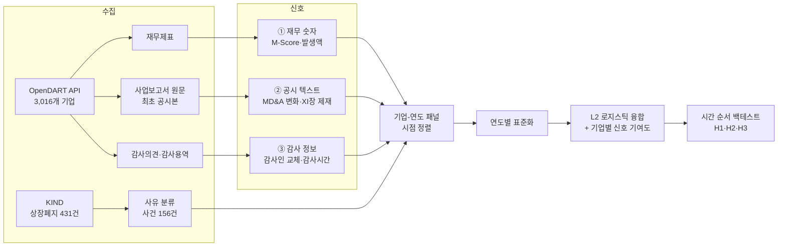
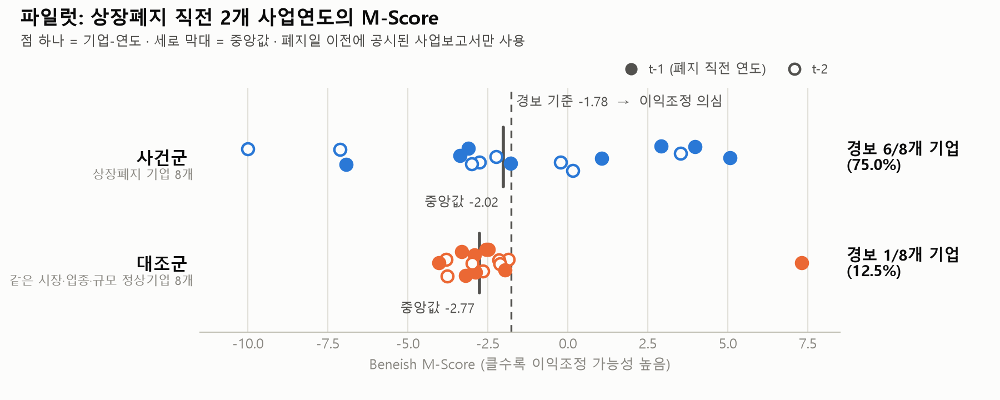

# 상장폐지 회피 위험 조기경보 모형

**숫자 · 텍스트 · 감사 신호를 융합한 설명가능한 위험 스코어링**

[](https://github.com/triple-signal/delisting-risk-early-warning/actions/workflows/tests.yml)


한국회계학회 제6회 대학생 회계경진대회 세션 2(AI 활용 회계분석) 출품 연구에서 출발해, 대회 이후에도 계속 개발하고 있는 프로젝트입니다.
공개 공시자료(DART·KIND)만 사용해 유가증권·코스닥 상장사의 상장폐지 위험을 사전에 포착하는 것을 목표로 합니다.

팀 트리플 시그널 (숭실대학교) · 강태욱, 김효준, 임근영

| 표본 | 기업-연도 | 사업보고서 원문 | DART API 호출 | 상장폐지 사건 |
|:---:|:---:|:---:|:---:|:---:|
| **3,016**개 기업 | **19,901**<br>(2018~2025) | **21,975**건<br>(최초 공시본) | **7만 회+**<br>(하루 한도 안에서 자동 분할) | **156**건<br>(431건 중 선별) |

### 진행 상황

- [x] 연구 설계 · 상장폐지 사유 분류 · M-Score 모듈 (2026-11-06)
- [x] 파일럿: 사건 8개 + 매칭 대조군 8개, 미래 정보 누출 발견 후 기준 수정 (2026-11-09)
- [x] 감사 · 텍스트 신호, 표준화 · 융합 모듈 (2026-11-10)
- [ ] 전체 표본 수집 — 재무제표 · 감사 완료, 사업보고서 원문 마무리 중 (2026-11-18 완료 예정)
- [ ] 기업-연도 패널 구성 (재무 · 감사 · 텍스트 신호 + 라벨)
- [ ] 융합 모형 적용, 가설 검증 H1 · H2 · H3

---

## 왜 이 연구인가

2026년 상장폐지 요건 강화(시가총액 기준 상향, 동전주 요건 신설 등)와 금융감독원의 분식회계 무관용 기조로, 퇴출 위기 기업이 재무제표·공시를 조작해 상장을 유지하려는 유인이 커졌습니다.
기존 부실 예측은 주로 재무 숫자에 의존하지만, 상장폐지 회피 행동은 **공시 서술의 변화**나 **감사 측 신호**(감사인 교체, 감사시간·보수 변화)로 먼저 나타날 수 있습니다.

| 연구질문 | 가설 |
|---|---|
| RQ1. 융합 점수가 단일 지표보다 상장폐지·제재를 더 정확히 예측하는가? | 융합 모형의 예측력이 단일 지표보다 높다 |
| RQ2. 세 신호 중 무엇이 가장 먼저 나타나는가? | 감사 신호가 재무 신호보다 선행한다 |
| RQ3. 상장폐지 개혁 전후로 경계선 기업의 회피 신호가 늘었는가? | 개혁 발표(2026.2.) 이후 회피 신호가 증가한다 |

## 방법



| 신호 | 내용 | 상태 |
|---|---|---|
| ① 재무 숫자 | Beneish M-Score 8변수, 발생액 | 구현·파일럿 완료 |
| ② 공시 텍스트 | 감사보고서 강조사항(계속기업 불확실성 등), 경영진단(MD&A) 서술의 연도별 변화량, 사업보고서 XI장의 제재·소송·사고 사실 추출 | 구현 (임베딩 방식은 추가 예정) |
| ③ 감사 정보 | 감사인 교체, 감사시간·감사보수 변화, 비정상 감사시간 | 구현 |
| 표준화 | 방향 통일 → 규모·업종 효과 제거 → 연도별 극단값 처리 → 연도별 z점수 | 구현 (가상 자료로 검증) |
| 융합 | L2 규제 로지스틱 회귀 + 기업별 신호 기여도. 단일 신호·동일가중과 비교, 부스팅으로 강건성 확인 | 구현 (가상 자료로 검증), 전체 표본 적용 예정 |

설계의 세부 기준(표본, 라벨, 임계값, 결정 이력)은 [docs/research_design.md](docs/research_design.md)에 모두 기록하고, 코드는 이 문서를 따릅니다.

## 설계 판단 기록

자료를 다루며 부딪힌 문제와, 회계·감사 관점에서 내린 판단입니다. 전체 이력은 [research_design.md](docs/research_design.md)의 변경 이력에 있습니다.

| 문제 | 판단 | 근거 |
|---|---|---|
| 파일럿 사건 기업 7개 중 3개의 "직전 연도" 사업보고서가 **폐지일 이후에 공시**됨 | 폐지일 이전에 공시된 보고서 중 최근 2개 사업연도만 사용 | 폐지 후 공시된 숫자로 폐지를 "예측"하면 미래 정보 누출. 실제 경보 시점에 알 수 없던 정보 |
| 기업-연도의 **24%에 정정공시** 존재 | 원문·공시일은 회사·연도별 **최초** 사업보고서 기준 | 정정본에는 사후에 알려진 사실이 반영됨. 재무제표 API 값은 정정 반영 최신값이라는 한계는 따로 기록 |
| 사건 기업 8개 중 6개는 비교 연도에 이미 **비적정 의견·거래정지 강조사항**이 있음 | 이런 기업-연도를 "사유 발생 후"로 표시하고, **뺀 분석을 함께 제시** | 이미 공개된 상장폐지 사유를 맞히는 것은 조기경보가 아님. 실제 선행 신호만 따로 확인 |
| 2018 신외부감사법, 2019 표준감사시간제로 **감사시간·보수 수준이 연도별로 바뀜** | 사업연도별 윈저화·z점수, 감사시간은 규모·업종 효과를 회귀 잔차로 제거 | 제도 변화를 위험 신호로 오인하지 않기 위함 |
| 당해 보고서의 "전기" 금액이 전년 보고서의 "당기"와 다른 사례 | "전기 불일치" 열로 표시해 원자료 오류·재작성을 추적 | DART가 전년 숫자를 그대로 반환한 원자료 오류 사례를 실제로 발견 |

- **대조군 매칭**: 같은 시장 · 업종 중분류 · t-2 자산규모가 가장 가까운 정상기업을 1:1로 매칭합니다.
- **연구윤리**: 기업 실명은 상장폐지가 확정된 사례로 한정하고, 현재 상장 기업은 식별번호로만 표시합니다.

## 파일럿 결과 (2026-11-09)

상장폐지 사건 기업 8개와 매칭된 정상기업 8개의, 폐지 직전 2개 사업연도 M-Score를 비교했습니다.

<picture>
  <source media="(prefers-color-scheme: dark)" srcset="docs/figures/pilot_mscore_dark.png">
  
</picture>

| | 기업 수 | M-Score 경보(−1.78 초과) 기업 | 경보 비율 | M-Score 중앙값 |
|---|---|---|---|---|
| 사건군 | 8 | 6 | 75% | −2.02 |
| 대조군 | 8 | 1 | 12.5% | −2.77 |

표본이 작아 통계적 결론은 아니며, 방향성과 파이프라인 동작을 확인한 단계입니다. 파일럿에서 드러난 한계(극단값, 감가상각비 미검출, 사건 시점 정의)와 대응은 [research_design.md 8절](docs/research_design.md)에 정리했습니다.
그림은 `scripts/make_figures.py`로 수집 자료에서 다시 만들 수 있습니다.

## 팀과 역할

| 구분 | 내용 | 해당 코드 |
|---|---|---|
| 팀 공동 작업 (실무 주도: 강태욱) | 연구 설계 문서 작성 · OpenDART 재무데이터 수집, M-Score 산출 코드, 계정명 표준화·결측 대체 내역 기록 | `docs/research_design.md`, `src/dart.py`, `src/mscore.py` |
| 임근영 | M-Score 산출값을 실제 상장폐지 결과·대조군과 비교해 신뢰도·유효성 검증 · 재무 신호에 공시 텍스트·감사 정보 신호를 더해 표준화하고 통계·머신러닝으로 합쳐 종합 위험점수를 매기는 기준 개발 · 기업별 신호 기여도 표시 방식 설계 · 사건 발생 이전 정보만 쓰는 시점 정렬 원칙 수립 · 팀 의견이 갈렸을 때 세 신호 융합 방향 제안 | `src/pilot.py`, `src/company.py`, `src/audit.py`, `src/disclosure.py`, `src/standardize.py`, `src/fusion.py` |
| 강태욱 | KIND 상장폐지 자료 수집·분류(431건 → 부실·회계 관련 156건) · 전체 수집 자료 정리, 기업-연도 패널 구성 (재무·감사·텍스트 신호와 라벨 결합) | `src/labels.py`, `src/panel.py` (진행 예정) |

## 레포 구조

```
docs/research_design.md          연구 설계 기준 문서 (결정·가정·미정 사항과 이력)
docs/figures/                    README 그림
src/dart.py                      OpenDART API 수집: 기업 목록, 재무제표
src/labels.py                    KIND 상장폐지 사유 분류 (부실 사건 / 보류 / 제외)
src/mscore.py                    Beneish M-Score 계산 (IFRS 계정ID 우선 탐색, 결측 중립값 기록)
src/pilot.py                     파일럿: 사건 기업 선정, 시점 정렬, 대조군 매칭, 검증
src/company.py                   기업개황(시장·업종·결산월), 다중회사 자산총계 수집
src/audit.py                     감사 신호(감사인 교체, 감사시간·보수 변화)와 감사보고서 강조사항 수집·정형화
src/disclosure.py                사업보고서 원문 수집, MD&A 변화량, XI장 제재·소송·사고 추출
src/standardize.py               신호 표준화 (비정상값 회귀 잔차, 연도별 윈저화·z점수, 결측 표시)
src/fusion.py                    융합 모형·기업별 기여도·시간 순서 분할·평가
src/collect.py                   전체 표본 수집 (하루 호출 한도·중단 후 이어받기·중복 실행 방지·네트워크 장애 처리)
tests/                           단위 테스트 65개 (자료·API 키 없이 실행, GitHub Actions에서 Windows·Ubuntu 자동 검사)
scripts/                         예약 수집 실행 파일, 그림 생성
notebooks/                       테스트·파일럿 노트북
```

## 실행 방법

1. Python 3.14 가상환경을 만들고 `pip install -r requirements.txt`
2. [OpenDART](https://opendart.fss.or.kr)에서 인증키를 발급받아 프로젝트 폴더의 `.env` 파일에 `DART_API_KEY=발급받은키` 저장
3. [KIND](https://kind.krx.co.kr) 상장폐지현황을 시장별로 내려받아 `data/raw/`에 저장 (파일명은 `src/labels.py` 참고)
4. `notebooks/03_pilot_mscore.ipynb` 실행 (파일럿), `python -m src.collect` (전체 표본 수집)

테스트는 자료 없이 돌아갑니다: `pip install -r requirements-dev.txt` 후 `python -m pytest`

수집 자료(`data/`)와 인증키는 레포에 포함하지 않습니다.

## AI 활용

데이터 수집·분석 코드 구현과 공시 자료 점검에 AI 코딩 도구(Claude Code)를 활용했습니다.
연구 설계, 회계·감사 판단, 기준 결정은 팀이 직접 하고, 그 결정과 근거를 `docs/research_design.md`에 남겼습니다.
[CLAUDE.md](CLAUDE.md)는 AI 도구가 작업할 때 읽는 프로젝트 안내서입니다.
